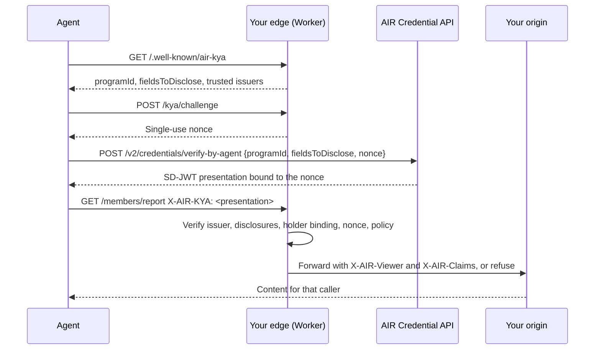

Know Your Agent (KYA) is the receiving side of AIR Agent. When an agent visits your site on a user's behalf, it can carry a proof of what the user holds, such as a membership tier. Your site checks that proof and decides what the agent gets.

This guide shows how to do that check at the edge, with a Cloudflare Worker in front of any existing site. Your origin does not change except to read one header.

<Card title="air-kya-edge" icon="github" href="https://github.com/MocaNetwork/air-kya-edge" horizontal>
  The example repository for this guide: a small Worker, a reusable KYA module, an example agent and origin, and tests for every rejection.
</Card>

## What you build

The Worker verifies an SD-JWT presentation that the agent obtained from AIR, offline, on every request it protects. It never calls AIR per request and never trusts a status relayed by the agent.



Each request is classified, then handled by the rule for its path:

| Caller sends | `X-AIR-Viewer` | `gate` path | `triage` path |
| --- | --- | --- | --- |
| No `X-AIR-KYA` header | `anonymous` | 403 | Forwarded |
| A proof that fails any check | `ineligible` | 403 | Forwarded |
| A valid proof that meets your policy | `eligible` | Forwarded, with claims | Forwarded, with claims |

- **Gate** a path to serve it only to verified agents, such as member-only content or a limited offer.
- **Triage** a path to serve everyone but let your origin tailor the response, such as member prices, higher rate limits, or a prompt to verify.

<Note>
  `anonymous` means the caller sent no proof. It is not a proof of humanity: people and unverified bots both land there. If you need that distinction, combine it with Cloudflare Bot Management.
</Note>

## Before you start

- **A verification program.** In the AIR Dashboard, create an `SD_JWT_VC` verification program for the credential you accept. Save its program ID, the issuer DID (`did:web:…`) and the credential type (`vct`). See [Verifying credentials](/products/identity/verify).
- **A Cloudflare account** with your site's domain on Cloudflare, or a `workers.dev` subdomain for testing.
- **Node.js 20 or later.**

You can complete the local steps without an AIR account. The repository includes a test issuer that signs credentials in AIR's format.

## Build and run it

<Steps>
  <Step title="Clone the repository and run it locally">
    ```bash
    git clone https://github.com/MocaNetwork/air-kya-edge.git
    cd air-kya-edge
    npm install
    npm run setup
    ```

    `npm run setup` creates a local test issuer and a `.dev.vars` that trusts it. Then run the example origin and the edge in two terminals:

    ```bash
    npm run origin   # example origin on :8788
    npm run dev      # the edge on :8787
    ```
  </Step>
  <Step title="Try each outcome">
    The example agent runs the full agent flow. `--fixture` signs the credential with the local test issuer instead of calling AIR; the edge checks are the same as in production.

    ```bash
    curl -s http://127.0.0.1:8787/members/report
    # 403 {"error":"kya_required","viewer":"anonymous","reason":"no_credential",...}

    npm run agent -- http://127.0.0.1:8787/members/report --fixture
    # 200 viewer=eligible reason=policy_satisfied

    npm run agent -- http://127.0.0.1:8787/members/report --fixture --tier Silver
    # 403 viewer=ineligible reason=condition_not_met:tier

    npm run agent -- http://127.0.0.1:8787/members/report --fixture --replay
    # 200, then 403 reason=nonce_reused_or_unknown

    npm run agent -- http://127.0.0.1:8787/pricing --fixture
    # 200, the origin serves member prices
    ```
  </Step>
  <Step title="Set your policy and rules">
    Edit `kya.config.ts`. The policy mirrors your verification program; the rules decide where it applies.

    ```ts kya.config.ts
    export const policy = (env: Env) =>
      definePolicy({
        programId: env.KYA_PROGRAM_ID,
        trustedIssuers: list(env.KYA_TRUSTED_ISSUERS),
        vct: env.KYA_VCT,
        fieldsToDisclose: ["tier"],
        conditions: [{ attribute: "tier", operator: "in", value: ["Gold", "Platinum"] }],
      });

    /** First match wins. Unmatched paths pass through without a check. */
    export const rules: Rule[] = [
      { path: "/members/*", mode: "gate" },
      { path: "/assets/*", mode: "off" },
      { path: "/*", mode: "triage" },
    ];
    ```

    - `fieldsToDisclose` is exactly what the agent must reveal: no more, no less. Ask only for the claims your decision needs.
    - `conditions` support `=`, `!=`, `>`, `>=`, `<`, `<=` and `in`. Each condition's attribute must be in `fieldsToDisclose`.
    - A rule `path` is exact (`/pricing`) or a prefix ending in `*` (`/members/*`). Modes are `gate`, `triage` and `off`.
  </Step>
  <Step title="Deploy in front of your site">
    Set your program ID, issuer and credential type as Worker vars in `wrangler.jsonc`, and add a route for your domain:

    ```jsonc wrangler.jsonc
    "vars": {
      "KYA_PROGRAM_ID": "<verification-program-id>",
      "KYA_TRUSTED_ISSUERS": "did:web:issuer.example.com",
      "KYA_VCT": "<credential-type>",
      "ORIGIN_URL": ""
    },
    "routes": [{ "pattern": "example.com/*", "zone_name": "example.com" }]
    ```

    With `ORIGIN_URL` empty, the Worker forwards to your zone's existing origin. Set it only to proxy a different host, for example while testing on `workers.dev`.

    ```bash
    npx wrangler secret put KYA_ORIGIN_SECRET
    npm run deploy
    ```
  </Step>
  <Step title="Read the decision in your origin">
    The edge removes every caller-supplied `X-AIR-*` header, including the proof, then adds its own:

    | Header | Value |
    | --- | --- |
    | `X-AIR-Viewer` | `anonymous`, `ineligible` or `eligible` |
    | `X-AIR-Reason` | Why; see [Reason codes](#reason-codes) |
    | `X-AIR-Claims` | Eligible only: the disclosed claims as base64url JSON, such as `{"tier":"Gold"}` |
    | `X-KYA-Origin-Secret` | Your shared secret |

    Your origin should accept these headers only from the edge. Refuse any request without the secret, and compare it in constant time:

    ```ts
    import { createHash, timingSafeEqual } from "node:crypto";

    const digest = (value: string) => createHash("sha256").update(value).digest();
    const fromEdge = (sent: string | undefined) =>
      !!sent && timingSafeEqual(digest(sent), digest(process.env.KYA_ORIGIN_SECRET!));

    // In a request handler:
    if (!fromEdge(req.headers["x-kya-origin-secret"])) return res.status(403).end();
    const viewer = req.headers["x-air-viewer"]; // "anonymous" | "ineligible" | "eligible"
    const claims = viewer === "eligible"
      ? JSON.parse(Buffer.from(req.headers["x-air-claims"], "base64url").toString())
      : {};
    ```

    For an origin behind Cloudflare's proxy, Authenticated Origin Pulls or a Cloudflare Tunnel can also keep traffic from bypassing the edge.
  </Step>
</Steps>

## What the agent does

An agent needs a delegated identity and an agent session first. See [Using Agentic Identity](/products/agents/partner-agent-api). For each protected request, it then:

1. Reads `GET /.well-known/air-kya` to learn the program, required claims and accepted issuers.
2. Gets a nonce from `POST /kya/challenge`. Each nonce expires after 60 seconds and works once.
3. Calls [Verify a credential](/api-reference/agents/verify-credential-by-agent) with the site's program, fields and nonce:

   ```ts
   const res = await fetch(`${CREDENTIAL_API}/v2/credentials/verify-by-agent`, {
     method: "POST",
     headers: { "Content-Type": "application/json", Authorization: `Bearer ${agentJwt}` },
     body: JSON.stringify({ programId, fieldsToDisclose, nonce }),
   });
   const { verificationResult } = await res.json();
   const proof = verificationResult.verifiablePresentation.verifiableCredential[0];
   ```

4. Sends the request with `X-AIR-KYA: <proof>`.

The repository's `examples/agent.ts` runs these steps against a live site when you set `AIR_AGENT_JWT`:

```bash
AIR_AGENT_JWT=<agent session token> npm run agent -- https://example.com/members/report
```

A gate refusal returns `403` with a `Link: </.well-known/air-kya>; rel="service-desc"` header, so an agent that arrives without a proof can find out what to present.

## What the edge checks

The Worker runs the [SD-JWT backend checks](/products/identity/verify-sd-jwt#checks) in this order. The first failure decides the reason code.

1. The issuer is in `trustedIssuers`. Its ES256 key comes from its `did:web` document (`assertionMethod`, matching `kid`).
2. The issuer signature, `iat`, `exp` and `vct` are valid.
3. The disclosed claims are exactly `fieldsToDisclose`, and each matches a digest the issuer signed.
4. The key-binding JWT is signed by the holder key in `cnf.jwk`, has `typ` `kb+jwt` and `aud` equal to the program ID, is at most 5 minutes old, and its `sd_hash` covers this presentation.
5. The nonce was issued by this site and is consumed now, atomically, in a Durable Object.
6. The policy conditions hold for the disclosed claims.

The verification logic lives in `src/kya/` and has no Cloudflare dependency apart from the nonce store. To run it in other middleware, such as Express or Next.js, pass your own `consumeNonce` backed by a store with an atomic delete.

## Reason codes

`X-AIR-Reason` carries one of these fixed codes. Tokens and library errors are never echoed.

| Reason | Meaning |
| --- | --- |
| `no_credential` | No `X-AIR-KYA` header. |
| `policy_satisfied` | Eligible. |
| `policy_not_configured` | Program ID, issuers or `vct` are missing. `/.well-known/air-kya` lists what is missing. |
| `invalid_credential` | Malformed presentation, bad issuer signature, or tampered disclosure. |
| `untrusted_issuer` | The issuer is not in `trustedIssuers`. |
| `did_unresolvable`, `did_mismatch`, `unknown_kid` | The issuer's key could not be found in its DID document. |
| `expired` | The credential has expired. |
| `unexpected_vct` | The credential type is not the one you accept. |
| `disclosure_mismatch` | The disclosed claims are not exactly `fieldsToDisclose`. |
| `holder_binding_required` | The presentation has no key-binding JWT, or the credential has no holder key. |
| `invalid_holder_binding` | The key-binding JWT's signature, `aud`, age or `sd_hash` is wrong. |
| `nonce_reused_or_unknown` | The nonce was not issued by this site, has expired, or was already used. |
| `condition_not_met:<claim>` | The proof is valid, but the condition on `<claim>` failed. |

Track these codes in your Worker logs. A spike in `nonce_reused_or_unknown` or `invalid_credential` from one source is a signal for your abuse controls.

## Before production

- **Revocation is not checked.** If your issuer publishes a Token Status List, add a status check. See [Revocation](/products/identity/verify-sd-jwt#revocation).
- **Rate-limit `/kya/challenge`** with a Cloudflare rate-limiting rule. Each call stores a nonce for 60 seconds.
- **Expect one proof per request.** A presentation is single-use. For high traffic, shard the nonce store.
- **Do not cache across caller classes.** The Worker sends responses to callers with a proof as `private, no-store` and fetches them with `cache: "no-store"`. If you add your own caching, key it on `X-AIR-Viewer`.
- **Keep the policy under your control.** Never let a caller choose the program, issuer or origin.
- **Know the binding's scope.** The proof is bound to your nonce and program, not to the HTTP connection. Request signing, such as Web Bot Auth (RFC 9421), is out of scope.

## Going further

- **People, too.** The [air-kya demo store](https://github.com/mocaverse/air-kya) runs the same checks for people who sign in with AIR Kit and verify the same credential in the browser. A verified person and their verified agent see the same catalog.
- **Decide what to gate.** [Agent Gating](/products/agents/agent-gating) covers which claims to ask for and how to combine them with your abuse controls.
- **Offer a benefit.** [Agentic Commerce](/products/agents/offers-for-agents) covers member pricing and other benefits applied after a successful check.
