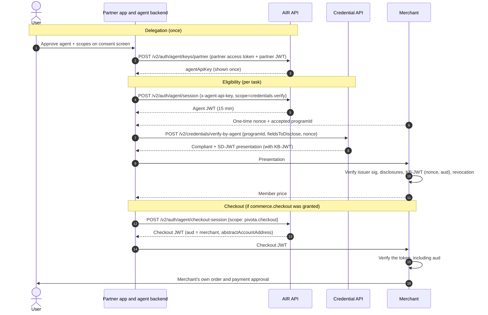

In agentic commerce, a software agent acts for a user: it proves the user qualifies for a benefit, such as a member price, and hands the user's identity to a merchant checkout. AIR provides the identity layer: a key bound to the user's AIR Account, short-lived scoped sessions, server-side credential verification, and audience-restricted checkout tokens. This page explains each primitive, how they compose into a purchase journey, and what each party can and cannot verify.

<Note>
  AIR Agent currently delegates **identity** only. An agent binding never grants wallet signing (`wallet.sign`), a spending mandate, or access to the user's assets. Delegation credentials (fine-grained, per-task grants) and wallet delegation are not yet released.
</Note>

## Four separate authorities

A merchant deciding on an agent's request answers four independent questions. AIR answers the first three. The fourth stays with the merchant's payment flow.

| Question | Answered by | Artifact |
| --- | --- | --- |
| Which agent is calling? | Agent authentication | Agent API key, or a P-256 signature from the agent's own key |
| Whom does it represent, and what may it do? | The user's binding and its scopes | Agent key record, and the `scope` in the agent JWT |
| Does the user qualify? | Credential verification | SD-JWT presentation from a verification program |
| May it pay? | The merchant's checkout and payment flow | Outside AIR. The checkout token identifies the user; it does not authorize payment. |

Holding one never implies another. A valid agent key does not prove eligibility. A verified Gold tier does not authorize a purchase.

## Identity primitives

### Agent key (the binding)

A user binds an agent once. The binding is an **agent key** record on the user's AIR Account:

```json
{
  "id": "3f1a9c8e-2b7d-4f60-a1c5-e9b8d7f6a4c2",
  "publicKey": null,
  "createdAt": "2026-08-19T12:00:00.000Z",
  "scope": "openid credentials.read credentials.verify",
  "nickname": "Shopping agent",
  "partnerId": "11111111-2222-4333-8444-555555555555",
  "agentApiKey": "air_ag_<secret>"
}
```

There are two ways to authenticate as that key:

| Model | At bind | At session creation | Fits |
| --- | --- | --- | --- |
| **API key** | AIR returns `agentApiKey` once | `x-agent-api-key` header | Partner-operated agent backends |
| **Agent-held P-256 key** | Send `publicKey` (PEM or base64 DER) | `signedMessage` in the body | Agents that manage their own keys, such as self-hosted runtimes |

With an agent-held key, the agent signs the canonical message `agent_pubkey:userId:unixEpochTime` (time in seconds) with ECDSA P-256. `userId` is the user's AIR user ID.

```ts
import { createSign } from "node:crypto";

// agentPubKey: the public key registered at bind, in the same encoding
const message = `${agentPubKey}:${userId}:${Math.floor(Date.now() / 1000)}`;
const signature = createSign("SHA256").update(message).sign(agentPrivateKeyPem).toString("base64"); // DER

const body = {
  scope: "openid credentials.read credentials.verify",
  signedMessage: { message, signature, publicKey: agentPubKey },
};
```

The signature can be DER or IEEE P1363 (ES256), in standard base64 or base64url. Send exactly one identity per request: the header or `signedMessage`. The timestamp in the message limits how long a captured signature stays useful.

{/* TODO: Confirm the encoding of agent_pubkey inside the signed message and the accepted timestamp window once published. */}

### Scopes

Scopes are fixed when the key is bound. AIR always adds `openid`.

| Scope | Grants | Enforced by |
| --- | --- | --- |
| `credentials.read` | `GET /v2/credentials`: list credential metadata (`storagePath`, `schemaId`, `issuerDid`, `vct`) | Credential API |
| `credentials.verify` | `POST /v2/credentials/verify-by-agent`: run a verification program | Credential API |
| `commerce.checkout` | `POST /v2/auth/agent/checkout-session`: mint a merchant checkout token | AIR API |
| `wallet.sign` | Not available on partner binding. Requesting it returns `403`. | AIR API |

To widen scopes, get the user's approval, bind a new key, and revoke the old one.

### Tokens

| Token | Lifetime | Audience | Scope | Accepted by |
| --- | --- | --- | --- | --- |
| `agentApiKey` (`air_ag_…`) | Until rotated or revoked | — | — | AIR API: session and checkout creation |
| Agent JWT | 15 minutes, no refresh | — | Subset of the bound scopes | Credential API: list, verify |
| Checkout JWT | Short-lived, no refresh | The merchant | The checkout target, such as `pivota.checkout` | **Only** the merchant. AIR and the Credential API reject it. |

Each session can request a narrower scope than the key holds. A `verify` operation does not need a token that can also start checkouts.

## Host topology and headers

| Environment | AIR API (keys, sessions, checkout) | Credential API (list, verify) |
| --- | --- | --- |
| Sandbox | `https://air.api.sandbox.air3.com` | `https://credential-testnet.api.sandbox.air3.com` |
| Production | `https://air.api.air3.com` | `https://credential-mainnet.api.air3.com` |

| Header | Carries | Used on |
| --- | --- | --- |
| `x-partner-id` | Partner ID | Key routes, session creation |
| `x-partner-access-token` | The user's AIR Kit token from `getAccessToken()`: proof the user is present | Bind, list, rename, rotate, revoke |
| `x-partner-jwt` | Fresh JWT signed with the partner login key: proof the partner backend is asking | Bind, rotate, revoke |
| `x-agent-api-key` | The agent's API key | Session and checkout creation |
| `Authorization: Bearer` | Agent JWT | List and verify |

Binding needs **both** the user's session token and a partner-signed JWT. A partner cannot bind an agent to a user who is not signed in, and a stolen user token cannot bind without the partner's key.

## End-to-end journey: member price to checkout



### 1. Bind (once, with consent)

There are two delegation journeys:

- **Through the AIR app** (standard): the user approves the agent in the AIR app. The app link is coming soon; contact the AIR team for this flow.
- **Within your application** (partner-managed, shown here): your app collects consent and your backend binds the key. Contact the AIR team to enable it. Agent keys must be enabled for your partner account, or AIR API calls return `403 AGENT_KEYS_DISABLED`.

AIR Kit also exposes `getAgentKeys`, `registerAgentKey`, and `removeAgentKey`, which run in the user's own session.

In the partner-managed route, the bind request has no approval screen of its own. Your application must show the agent's nickname and each requested scope, collect approval, and keep a record of it.

```bash
curl -X POST "$AIR_API/v2/auth/agent/keys/partner" \
  -H "Content-Type: application/json" \
  -H "x-partner-id: $PARTNER_ID" \
  -H "x-partner-access-token: $PARTNER_ACCESS_TOKEN" \
  -H "x-partner-jwt: $PARTNER_JWT" \
  -d '{ "scope": "credentials.read credentials.verify commerce.checkout", "nickname": "Shopping agent" }'
```

### 2. Open a scoped session per operation

```bash
curl -X POST "$AIR_API/v2/auth/agent/session" \
  -H "Content-Type: application/json" \
  -H "x-partner-id: $PARTNER_ID" \
  -H "x-agent-api-key: $AGENT_API_KEY" \
  -d '{ "scope": "openid credentials.verify" }'
```

```json
{
  "accessToken": "<agent JWT>",
  "user": { "id": "018f9a2b-7c3d-7e10-9a4b-2c1d5e6f7a8b", "abstractAccountAddress": "0x…" }
}
```

A requested scope outside the bound set fails with `403 AGENT_SCOPE_DENIED`.

### 3. Verify eligibility server-side

```bash
curl -X POST "$CREDENTIAL_API/v2/credentials/verify-by-agent" \
  -H "Content-Type: application/json" \
  -H "Authorization: Bearer $AGENT_JWT" \
  -d '{ "programId": "<merchant-accepted program>", "fieldsToDisclose": ["tier"], "nonce": "<merchant challenge>" }'
```

```json
{
  "verificationResult": {
    "status": "Compliant",
    "verifiablePresentation": {
      "@context": ["https://www.w3.org/2018/credentials/v1"],
      "type": ["VerifiablePresentation"],
      "holder": "did:…",
      "verifiableCredential": ["<issuer-jwt>~<disclosure: tier>~<kb-jwt>"]
    }
  }
}
```

- `fieldsToDisclose` omitted: an SD-JWT program discloses the claims it queries. `"*"` attaches every disclosable claim.
- `nonce` is required when the credential has `cnf.jwk`. Every AIR-issued SD-JWT credential has it.
- This endpoint accepts agent JWTs only. A user JWT gets `403`.

Let the **merchant** generate the nonce when the merchant will verify the presentation itself. The KB-JWT then binds the presentation to the merchant's challenge, and the agent cannot replay an old presentation.

### 4. Hand evidence to the merchant

The merchant chooses its trust model:

| Model | Merchant receives | Merchant verifies | Merchant must trust |
| --- | --- | --- | --- |
| **Independent verification** (recommended) | The compact SD-JWT | Issuer signature against its issuer allowlist, disclosures, `vct`, `exp`, KB-JWT (`nonce` = its challenge, `aud` = `programId`, `iat`, `sd_hash`), revocation | Nothing beyond the issuer |
| **Backend attestation** | `status` from the agent backend | Nothing cryptographic | The agent backend's report. `status` is not signed. |

The checks are the same as for any verifier. See [Checking a presentation](/technicals/architecture/how-credential-verification-works/backend-checks).

### 5. Checkout handoff

With `commerce.checkout`, the agent mints a token for a supported merchant:

```bash
curl -X POST "$AIR_API/v2/auth/agent/checkout-session" \
  -H "Content-Type: application/json" \
  -H "x-partner-id: $PARTNER_ID" \
  -H "x-agent-api-key: $AGENT_API_KEY" \
  -d '{ "scope": "pivota.checkout" }'
```

```json
{
  "accessToken": "<checkout JWT>",
  "user": { "id": "018f9a2b-…", "abstractAccountAddress": "0x…" }
}
```

The request `scope` names the merchant checkout target, not an agent scope. `pivota.checkout` is currently the only supported value. The JWT's `aud` is the merchant mapped to that target, and it carries the user's AIR Account (abstract account) address. The merchant must check `aud`. AIR and the Credential API reject the token because of its audience, so a leaked checkout token cannot be used to read or verify credentials.

The checkout token **identifies** the user to the merchant. Ordering and payment follow the merchant's own approval and payment flow.

## Key lifecycle

| Operation | Endpoint | Effect on existing agent JWTs | Effect on new sessions |
| --- | --- | --- | --- |
| List | `GET /v2/auth/agent/keys/partner` | — | — (never returns `agentApiKey`) |
| Rename | `PATCH /v2/auth/agent/keys/partner/{id}` | None | None |
| Rotate | `POST /v2/auth/agent/keys/partner/{id}/rotate` | **Invalidated** | Need the new `agentApiKey` |
| Revoke | `DELETE /v2/auth/agent/keys/partner/{id}` | Not documented as invalidated. Rotate first to end them. | Fail (`401`) |

To disconnect an agent immediately, **rotate, then revoke**. Rotation kills outstanding JWTs, and revocation stops new ones. Each user has a limited number of agent keys. Binding past the limit returns `409 CONFLICT_REQUEST`.

## Threat model

| Threat | Mitigation | Residual risk and owner |
| --- | --- | --- |
| Leaked `agentApiKey` | Backend-only storage. Rotate to invalidate, revoke to disable. Scopes cap the blast radius. | Valid until rotated. The partner must detect the leak. |
| Leaked agent JWT | 15-minute lifetime, no refresh, narrow per-operation scope | Usable until expiry |
| Replayed presentation | Merchant-generated single-use nonce plus KB-JWT `iat` window | None if the merchant consumes its nonce |
| Scope escalation | Session scopes must be a subset of the bound key (`403 AGENT_SCOPE_DENIED`). Scopes are fixed at bind. | — |
| Checkout token misuse | `aud` = merchant. Rejected by AIR services. | The merchant must verify `aud` and expiry. |
| Binding without consent | Bind requires the user's live session token and a partner JWT | The partner owns the consent screen |
| One user, many keys to bypass quotas | Per-user key limit | Merchants should rate-limit per user, not per key |
| Overspending | Not enforced by AIR | The payment integration must enforce caps wherever money moves |
| Status spoofing | Independent verification of the SD-JWT | Merchants trusting `status` alone accept the agent backend's word |

## Error semantics that matter for commerce

| Response | Meaning | Correct handling |
| --- | --- | --- |
| `200` `status: "NotFound"` | The user has no matching credential | Offer issuance or the standard price. Verification never issues a credential. |
| `200` `status: "Non-Compliant"` | Credential found, conditions not met | Standard price |
| `502 CREDENTIAL_STORAGE_UNAVAILABLE` | Storage could not be read | Retry. Do **not** treat it as "not eligible". |
| `403 AGENT_KEYS_DISABLED` | Agent keys not enabled for the partner | Contact the AIR team |
| `401` on the Credential API | Agent JWT expired or invalid | Create a new session |

## Security properties

| Property | Mechanism |
| --- | --- |
| **Agent authentication** | API key, or ECDSA P-256 signature over a timestamped message |
| **User authorization** | Bind requires the user's AIR session and partner attestation. Scopes are fixed at bind. |
| **Least privilege** | Per-session scope subsets, 15-minute tokens |
| **Verifiable eligibility** | Issuer-signed SD-JWT with holder binding to the merchant's nonce |
| **Audience isolation** | Checkout JWTs usable only at the named merchant |
| **Revocability** | Rotate (invalidates issued agent JWTs) and revoke (stops new sessions) |

Not provided today:

- Per-merchant, per-claim, or per-action grants. Scopes are coarse.
- Spending limits or payment authority.
- A signed verification result for third parties other than the SD-JWT itself.

## Design rationale

- **Bind once, mint per operation.** The long-lived secret, the API key, never leaves the agent backend. What travels is a 15-minute token that cannot be refreshed.
- **Identity separated from payment.** A compromised identity binding cannot move money, because AIR holds no payment authority to delegate.
- **Merchant-chosen nonce.** It makes eligibility evidence fresh and specific to one merchant without a direct AIR-to-merchant integration.
- **Audience-restricted checkout.** The token that leaves AIR's ecosystem is useless anywhere but its merchant.

## Roadmap boundary

**Delegation credentials** (not yet released) would record a per-task grant: granting user, delegate agent, permitted claims, receiving application, duration, and permitted action. The receiving application would check the grant alongside the user's claims. **Wallet delegation** for Web3 use cases is planned separately. Neither exists in the current Agent APIs.

## Related

<CardGroup cols={2}>
  <Card title="How credential verification works" icon="magnifying-glass" href="/technicals/architecture/how-credential-verification-works">
    The checks a merchant runs on the presentation.
  </Card>
  <Card title="Keys & cryptography" icon="key" href="/technicals/architecture/keys-and-cryptography">
    Every key and token in the system.
  </Card>
  <Card title="Using Agentic Identity" icon="robot" href="/products/agents/partner-agent-api">
    Step-by-step integration guide.
  </Card>
  <Card title="Agent APIs reference" icon="code" href="/api-reference/agents/introduction">
    Endpoints, headers, and errors.
  </Card>
</CardGroup>
