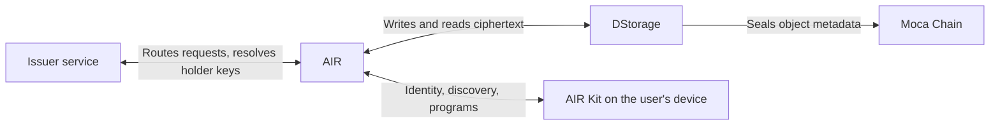

AIR sits between the issuer, the user, and storage. It identifies users, routes requests, and stores encrypted credentials, but it does not create, sign, or read them. This page goes through each stage describing what AIR does there.

## Stage by stage

| Stage | What AIR does | What the issuer does | What happens on the user's device |
| --- | --- | --- | --- |
| **Setup** | Registers the issuer's DID, endpoints, API key, and JWKS URL. Hosts schemas and programs in the Developer Dashboard. | Publishes its DID document and keys on its own domain | — |
| **Identify the user** | Maintains the user's AIR Account and DID, and keeps the user's **public** encryption and signing keys | Identifies the user in its own systems by its partner user ID | The user signs in to AIR |
| **Preview** (on-demand) | Calls the issuer's `available-vc` endpoint with the user's identity and public encryption key, then relays the encrypted previews | Loads claims and encrypts each preview to the user | Decrypts and shows the preview |
| **Issue** | Calls the issuer's `issue-vc` endpoint, adding the user's public signing key. For direct issuance, resolves the user by email instead. | Builds, binds, signs, and encrypts the credential | The user confirms (on-demand only) |
| **Store** | Receives the encrypted envelope through its DStorage API, writes it to Moca Chain storage providers, and returns a storage path | Calls the DStorage API with a Partner JWT | — |
| **Index** | Keeps cleartext metadata to find the credential later: holder DID, schema, format, expiry, storage path | Keeps its own issuance record, if it has a database | — |
| **Discover** (at verification) | Finds the user's credentials that match a verification program | — | Fetches the ciphertext and decrypts it locally |
| **Verify** | Loads the program, keeps a verification session record, and, when the program enables it, asks the issuer for revocation status | Answers revocation status requests | Records consent, builds the presentation, and signs it with the user's key |

## What AIR holds

| AIR holds | AIR does not hold |
| --- | --- |
| The user's AIR Account and DID | Issuer signing keys |
| The user's public encryption and signing keys | Plaintext claims inside stored credentials |
| Registered issuer configuration: DID, endpoint URLs, API key, JWKS URL | Issuer source records |
| Schemas and verification programs | |
| Credential metadata: holder, schema, format, expiry, storage path | |
| Verification sessions and consent records | |

## What AIR cannot do

- **Issue on an issuer's behalf.** It has no issuer keys, so it cannot produce a credential that a verifier would accept.
- **Change a credential.** Any change breaks the issuer's signature.
- **Read a stored credential.** It is encrypted to the user's key.
- **Revoke a credential.** Revocation runs on the issuer's own service.

## Where trust sits

The trust boundary is the **issuer**, not AIR. A verifier decides whether to accept a credential by checking the issuer's signature against keys the issuer publishes on its own domain. Nothing a verifier checks depends on trusting AIR's word, except when a verifier chooses to rely only on the unsigned result status instead of checking the presentation.

## Agent verification

When an AI agent verifies a user's credentials, the agent's backend calls AIR's Credential API instead of AIR Kit. AIR runs the verification program on the user's behalf, within the scopes the user granted to that agent, and returns the result and the disclosed claims. See [How agentic commerce works](/technicals/architecture/how-agentic-commerce-works).