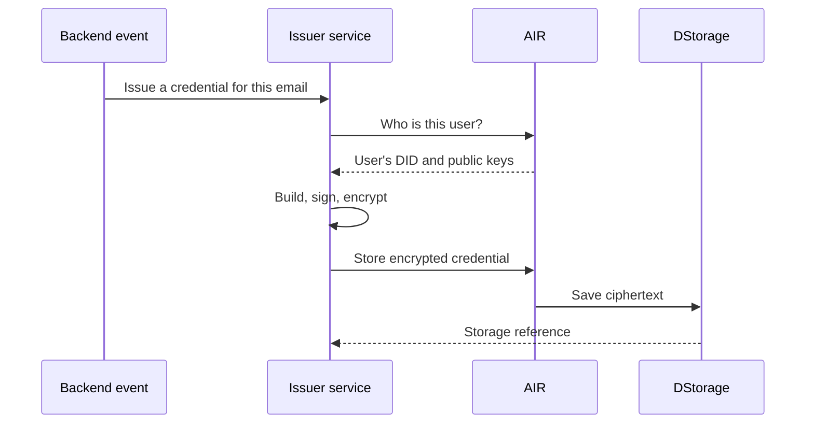

Direct issuance lets the issuer issue from its own backend, with no user session and no screen. The user does not need to open AIR or confirm anything; the credential is in their AIR Account the next time they use it.

Typical triggers:

- A user passes a KYC check.
- A purchase is confirmed or a subscription renews.
- A venue scan records an attendance.
- A loyalty tier changes.

## The flow

## Step by step

<Steps>
  <Step title="A backend event triggers issuance">
    The issuer's own servers call the issuer service's admin endpoint, protected by an admin key that never leaves the issuer's infrastructure.
  </Step>
  <Step title="AIR identifies the user">
    The issuer sends AIR the recipient's email inside a signed Partner JWT. AIR returns the user's DID, encryption key, and signing key. If the user has no AIR Account yet, AIR creates one.
  </Step>
  <Step title="The issuer builds the credential">
    The same build, bind, sign, and encrypt steps as on-demand issuance. Because AIR keeps every user's public keys, the credential is bound to the user even though they are offline.
  </Step>
  <Step title="The credential is stored">
    The encrypted credential is saved in DStorage. The user can present it to any AIR verifier from then on.
  </Step>
</Steps>

## Things to know

- The email must be the individual recipient's own address, never a shared or service address.
- If AIR cannot return the user's DID or encryption key, the issuer must not issue.
- Avoid duplicates: deduplicate by recipient and program, and revoke the old credential before issuing a changed one.

For implementation details, see [Direct issuance](/products/identity/issuing-credentials#direct-issuance) and the [Issuance API reference](/api-reference/issuance-api).
