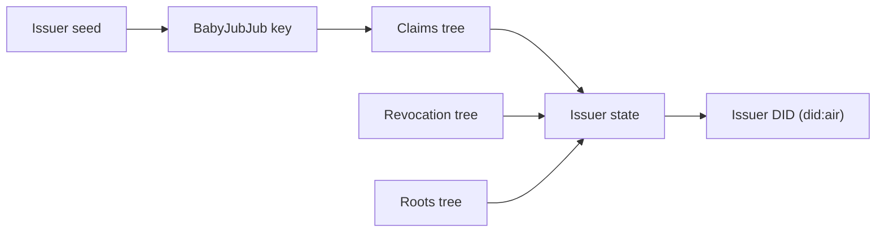

Iden3 is AIR's advanced credential format (`BJJ_SIG_2021`), which the AIR team enables per request. Where SD-JWT reveals the values a user chooses to share, Iden3 lets the user **prove a statement about a value without revealing it**, such as "tier is above Bronze" or "age is over 18", and every proof looks different, so verifiers cannot link them.

It achieves this by turning the credential into Merkle trees that a zero-knowledge circuit can reason about.

## The issuer's identity

An Iden3 issuer is not a domain. It is a cryptographic identity:

1. **A BabyJubJub key pair**, derived from the issuer service's secret 32-byte seed. BabyJubJub is an elliptic curve designed to be cheap inside zero-knowledge circuits.
2. **Three sparse Merkle trees** that describe the issuer's state:

   | Tree | Contains |
   | --- | --- |
   | **Claims tree** | The issuer's own public key, as an "authorization claim" |
   | **Revocation tree** | The revocation numbers of every credential the issuer has revoked |
   | **Roots tree** | The history of claims tree roots |

3. **The issuer state**: one hash computed from the three tree roots. Any change to the trees, such as a revocation, produces a new state.
4. **The issuer DID** (`did:air:…`), derived from the issuer's first (genesis) state. Changing the seed creates a different issuer.

## What a credential is made of

An Iden3 credential is a W3C Verifiable Credential in JSON-LD, plus a compact signed "core claim" that circuits can read.

<Steps>
  <Step title="The JSON-LD credential">
    The readable credential: the holder DID as `credentialSubject.id`, the claim fields, the schema URL, the JSON-LD context URL, the expiry, and a `credentialStatus` pointing to the issuer's `/credential-status` endpoint with a revocation number.
  </Step>
  <Step title="Merklization">
    Every field of the credential is turned into a key and value, using the JSON-LD context to give each field a precise meaning, and inserted into a sparse Merkle tree. The tree's root, the **merklized root**, commits to every field at once. This is why claim names and types must match the schema exactly: a mismatch changes the tree.
  </Step>
  <Step title="The core claim">
    A fixed-size record holding the schema hash, the holder's DID (in its index part), the merklized root (in its value part), the revocation number, and the expiry.
  </Step>
  <Step title="The signature">
    The issuer signs the core claim with its BabyJubJub key. The signature, with the issuer's state and the proof that the issuer's key is in its claims tree, is attached to the credential as its `BJJSignature2021` proof.
  </Step>
</Steps>

The credential is then encrypted to the holder and stored in DStorage, exactly like an SD-JWT credential. See [Where credentials are stored](/technicals/architecture/how-credential-issuance-works/storage).

## How a proof works

When a verification program asks a question such as "is `tier` above Bronze?", the holder's device runs a Circom circuit and produces a Groth16 zero-knowledge proof. The proof convinces the verifier that all of these are true, without revealing the credential:

| The circuit proves | Using |
| --- | --- |
| The issuer signed this core claim | The issuer's BabyJubJub signature |
| The issuer's key belongs to the issuer's state | A Merkle proof into the issuer's claims tree |
| The credential was issued to this holder | The holder DID in the core claim |
| The credential has not been revoked | A Merkle proof that the revocation number is **not** in the revocation tree |
| The field exists and meets the condition | A Merkle proof from the merklized root to the field, and the comparison |

The verifier receives the proof (`pi_a`, `pi_b`, `pi_c`), its public signals (the inputs and outputs the verifier is allowed to see, such as the issuer, the condition, and the result), and the circuit ID. It does not receive the field value unless the program asked for it. Generating a proof takes a few seconds of computation on the user's device.

A program can also ask for a field's actual value. The proof then shows the value is genuine, and the credential otherwise stays hidden.

## How a proof is verified

| Mode | How |
| --- | --- |
| **Off-chain** | The proof is checked with the circuit's verification key, outside a blockchain transaction. |
| **On-chain** | The proof is submitted to the Universal Verifier contract on Moca Chain, which calls a Groth16 verifier contract. The result is a transaction anyone can audit. |

## How revocation works

To revoke, the issuer adds the credential's revocation number to its revocation tree, which produces a new issuer state. When the holder builds a proof, it fetches a fresh **non-revocation proof** from the issuer's `/credential-status/:nonce` endpoint: a Merkle proof that the number is absent, together with the issuer's current tree roots and state. The issuer also answers the standard `/revocation-status/:nonce` endpoint. There is no token status list.

## SD-JWT and Iden3 compared

| | SD-JWT (default) | Iden3 |
| --- | --- | --- |
| Issuer identity | `did:web`, keys on the issuer's domain | `did:air`, derived from a BabyJubJub key |
| Signature | Issuer partner key, `RS256` or `ES256` | BabyJubJub |
| How claims are hidden | Salted SHA-256 fingerprints | Merkle tree of all fields |
| What a verifier learns | Exact values of shared claims | A condition, or a value if requested |
| Linkable presentations | Yes | No, each proof is randomized |
| Holder work | Near instant | Seconds |
| Revocation | Status endpoint or token status list | Revocation tree and non-revocation proof |
| On-chain verification | No | Optional |
| Data model | IETF SD-JWT VC | W3C VC Data Model 1.1, JSON-LD |

For setup, see [Issue Iden3 credentials](/products/identity/iden3/issuing). For verification modes, see [Zero-knowledge verification](/technicals/architecture/how-credential-verification-works/zero-knowledge).
