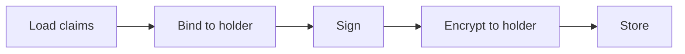

Issuance turns something an issuer already knows about a user, such as a membership tier or a completed KYC check, into a **credential** the user can carry to other apps. The issuer builds and signs the credential on its own service. AIR delivers it to the user and stores it encrypted. AIR never sees what is inside.

## The five steps behind every credential

Whichever way a credential is issued, the issuer's service performs the same five steps:

| Step | What happens | Why it matters |
| --- | --- | --- |
| **1. Load claims** | The issuer reads the facts from its own systems. | The issuer stays the source of truth. |
| **2. Bind to holder** | The issuer writes the user's public signing key into the credential. | A copy that leaks cannot be presented by anyone else. |
| **3. Sign** | The issuer signs the credential with a key published on its own domain. | Anyone can check it is genuine and unchanged. |
| **4. Encrypt** | The issuer encrypts the signed credential to the user's encryption key. | Only the user can read it. AIR and storage see ciphertext. |
| **5. Store** | The encrypted credential is saved in DStorage, with a record on Moca Chain. | The user finds it in their AIR Account. |

## Who is involved

| Participant | Role | Sees the claims? |
| --- | --- | --- |
| **Issuer service** | Runs on the issuer's infrastructure. Loads claims, signs, encrypts, stores, and handles revocation. | Yes, it is the source |
| **AIR** | Identifies the user, routes requests to the issuer, and stores encrypted credentials. | No |
| **AIR Kit** | Runs in the user's browser or app. Shows previews and gets the user's confirmation. | Only on the user's device |
| **DStorage** | Moca Chain's decentralized storage. Holds the encrypted credential. | No |
| **Moca Chain** | Records hashes and status metadata, never the credential itself. | No |

## Three ways to issue

| Mode | Is the user present? | Typical trigger | Read more |
| --- | --- | --- | --- |
| **On-demand** | Yes | The user clicks "claim" in your app and confirms a preview. | [On-demand issuance](/technicals/architecture/how-credential-issuance-works/on-demand) |
| **Direct** | No | A backend event: KYC passed, purchase confirmed, tier changed. | [Direct issuance](/technicals/architecture/how-credential-issuance-works/direct) |

## Two credential formats

| Format | In short | Read more |
| --- | --- | --- |
| **SD-JWT** (default) | A signed token whose claims hide behind salted fingerprints. The user reveals exact values, one claim at a time. | [How SD-JWT credentials work](/technicals/architecture/how-credential-issuance-works/sd-jwt) |
| **Iden3** (advanced) | Claims arranged in Merkle trees and signed with a ZK-friendly key. The user proves conditions without revealing values. | [How Iden3 credentials work](/technicals/architecture/how-credential-issuance-works/iden3) |

Both are encrypted to the user and stored the same way. See [Where credentials are stored](/technicals/architecture/how-credential-issuance-works/storage), and for AIR's part in every step, [Where AIR participates](/technicals/architecture/how-credential-issuance-works/air-role).

## What issuance guarantees

- **Authentic.** The issuer's signature proves who issued the credential and that nothing was changed.
- **Private.** Only the holder can decrypt it. AIR, storage providers, and chain observers cannot.
- **Holder-bound.** A verifier that asks for proof of possession rejects anyone who lacks the holder's private key.
- **Issuer-controlled.** AIR never holds issuer keys and cannot issue on an issuer's behalf.

What it does **not** guarantee: that the claims are true (that depends on the issuer's own checks), that two verifiers cannot link presentations of the same credential, or that disclosed copies disappear after revocation.

## In this section

<CardGroup cols={2}>
  <Card title="Where AIR participates" icon="sitemap" href="/technicals/architecture/how-credential-issuance-works/air-role">
    What AIR does, holds, and cannot do at each step.
  </Card>
  <Card title="Issuer setup" icon="gear" href="/technicals/architecture/how-credential-issuance-works/setup">
    What must exist before the first credential.
  </Card>
  <Card title="On-demand issuance" icon="hand-pointer" href="/technicals/architecture/how-credential-issuance-works/on-demand">
    The user previews and confirms.
  </Card>
  <Card title="How SD-JWT credentials work" icon="file-shield" href="/technicals/architecture/how-credential-issuance-works/sd-jwt">
    Fingerprinted claims, holder binding, and issuer keys.
  </Card>
  <Card title="How Iden3 credentials work" icon="diagram-project" href="/technicals/architecture/how-credential-issuance-works/iden3">
    Merkle trees, BabyJubJub signatures, and ZK proofs.
  </Card>
  <Card title="Where credentials are stored" icon="database" href="/technicals/architecture/how-credential-issuance-works/storage">
    The encrypted envelope, DStorage, and Moca Chain.
  </Card>
  <Card title="Revocation and updates" icon="ban" href="/technicals/architecture/how-credential-issuance-works/after-issuance">
    What happens after a credential is issued.
  </Card>
</CardGroup>

To build an issuer, follow the developer guide: [Issuing credentials](/products/identity/issuing-credentials).
