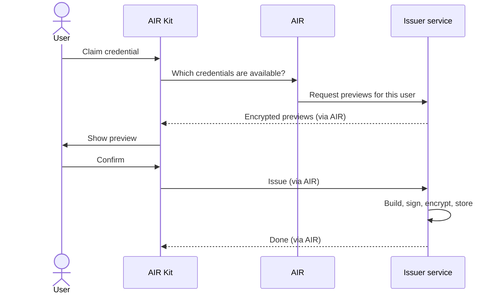

On-demand issuance runs while the user is in your app. The user sees exactly what they will receive before anything is created, then confirms. It is the default for flows like "claim your membership credential".

## The flow

## Step by step

<Steps>
  <Step title="The app starts issuance">
    Your app calls AIR Kit with a Partner JWT and the issuance program. If the user is not signed in to AIR, AIR Kit signs them in first. AIR then knows who the user is and which keys belong to them.
  </Step>
  <Step title="The issuer prepares a preview">
    AIR asks the issuer which credentials this user can claim. The issuer looks the user up by the partner user ID that AIR resolves from the signed-in session, loads the claims, and returns a **preview** encrypted to the user.

    A preview is not a credential: it is unsigned and stored nowhere. AIR passes it along without being able to read it.
  </Step>
  <Step title="The user reviews and confirms">
    AIR Kit decrypts the preview on the user's device and shows it. Nothing is issued unless the user confirms.
  </Step>
  <Step title="The issuer issues">
    AIR asks the issuer to issue, passing the user's public signing and encryption keys. The issuer loads the claims again from its own systems rather than trusting the preview, then builds the credential, binds it to the user's key, signs it, encrypts it, and stores it in DStorage.
  </Step>
  <Step title="The app gets the result">
    AIR Kit resolves once the credential is stored. A record of its hashes and status is also written to Moca Chain. If your next step is verifying the credential straight away, ask AIR Kit to wait for that record (`waitForOnchainCompletion`), because an immediate verification can fail while it is pending.
  </Step>
</Steps>

## What each party sees

| Party | Sees |
| --- | --- |
| User | The decrypted preview and the final credential, on their own device |
| Your app | That issuance succeeded. Not the credential contents. |
| AIR | Who the user is, which issuer and schema, and encrypted data |
| Issuer | Its own claims, and the user's public keys |

## Things to know

- AIR calls the issuer's endpoints server to server with the issuer's API key. The browser never sees that key, and claims reach it only encrypted, to be decrypted on the user's device.
- The issuer authorizes each request with the partner user ID AIR resolved, not with the holder DID alone.
- A typical issuance completes in about 1 to 4 seconds.

For implementation details, see [SDK issuance](/products/identity/issuing-credentials#sdk-issuance) and the [Issuance API reference](/api-reference/issuance-api).
