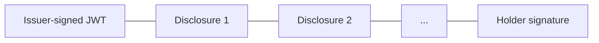

SD-JWT VC (Selective Disclosure JWT Verifiable Credential) is an IETF standard and AIR's default credential format (`SD_JWT_VC`). It is a signed JSON Web Token with one extra idea: claims can be **hidden behind fingerprints**, so the holder can reveal some and withhold others without breaking the issuer's signature.

## The structure

An SD-JWT is a chain of parts separated by `~`:

| Part | Created by | When | Contains |
| --- | --- | --- | --- |
| **Issuer-signed JWT** | Issuer | At issuance | Visible fields, plus a fingerprint of every hidden claim |
| **Disclosures** | Issuer | At issuance | One per hidden claim: the claim's name, value, and a random salt |
| **Holder signature** (key-binding JWT) | Holder's device | At each presentation | Proof that the holder approved this specific presentation |

At issuance, the holder receives the issuer-signed JWT and **every** disclosure. At presentation, the holder sends the JWT, only the disclosures the verifier asked for, and a fresh holder signature.

## The issuer-signed JWT

The JWT header names the algorithm (`RS256` or `ES256`), the type `dc+sd-jwt`, and the signing key as a DID URL such as `did:web:issuer.example#key-1`.

The payload carries:

| Field | Purpose |
| --- | --- |
| `iss` | The issuer DID, `did:web:<issuer host>` |
| `sub` | The holder DID |
| `vct` | The credential type registered in the Dashboard |
| `id` | A unique credential identifier |
| `iat`, `exp` | Issuance and expiry time |
| `cnf.jwk` | The holder's public signing key (P-256) |
| `nonce` | The revocation number. Unrelated to any verifier challenge. |
| `status.status_list` | Optional pointer into the issuer's token status list |
| `_sd_alg` | The fingerprint algorithm, `sha-256` |
| `_sd` | The fingerprints of hidden claims |

Claims the issuer did not mark as hideable sit in the payload in plain view.

## How a claim is hidden and revealed

The issuer decides which claims are hideable, per credential type (its `disclosureFrame`). In direct issuance, every top-level claim is hideable by default. Nested claims such as `address.city` can be hidden individually.

A worked example for the claim `tier: Gold`:

| Step | Who | Result |
| --- | --- | --- |
| 1. Pick a random salt | Issuer | `_26bc4LT-ac6q2KI6cBW5es` |
| 2. Build the disclosure: salt, name, value | Issuer | `["_26bc4LT-ac6q2KI6cBW5es", "tier", "Gold"]`, then base64url-encoded |
| 3. Fingerprint it with SHA-256 | Issuer | `Ql8sY…`, placed in `_sd` |
| 4. Sign the JWT | Issuer | The signature now covers the fingerprint, not the value |
| 5. Present it, or don't | Holder | Include the disclosure only if the verifier asked and the user approved |
| 6. Check it | Verifier | Re-fingerprint the disclosure and find `Ql8sY…` in the signed `_sd` |

Why it is safe:

- **The issuer's signature still holds.** It covers the fingerprints, so revealing or withholding a disclosure does not touch the signed part.
- **A revealed value cannot be faked.** A different value produces a different fingerprint that is not in `_sd`.
- **A hidden value cannot be guessed.** Without the random salt, a verifier cannot fingerprint candidate values, such as every tier name, and look for a match.

What it does not do: a revealed claim reveals its exact value. SD-JWT cannot prove "over 18" without revealing the age; for that, the issuer either signs an `isOver18` claim or uses [Iden3](/technicals/architecture/how-credential-issuance-works/iden3).

## How holder binding works

Holder binding stops a copied credential from being presented by someone else.

1. **At issuance**, AIR gives the issuer the user's public signing key (EC P-256), and the issuer writes it into `cnf.jwk` before signing. Every AIR-issued credential has it, on both on-demand and direct issuance.
2. **At presentation**, the verifier sends a one-time challenge (nonce). The user's device signs a key-binding JWT (`kb+jwt`, `ES256`) with the matching private key. It contains:
   - `nonce`: the verifier's challenge, so the presentation cannot be replayed
   - `aud`: the verification program ID, so it cannot be reused for another program
   - `iat`: when it was signed, so stale presentations can be rejected
   - `sd_hash`: a SHA-256 of the JWT and the exact disclosures sent, so none can be added or removed
3. **The verifier** checks the key-binding JWT against `cnf.jwk` from the issuer-signed JWT.

Without a challenge, there is no key-binding JWT and the presentation is a bearer token.

## How verifiers find the issuer's keys

The issuer's identity is `did:web:<issuer host>`. A verifier turns it into a URL, `https://<issuer host>/.well-known/did.json`, fetches the DID document, and takes the public keys listed under `assertionMethod`. It selects the one named by the JWT header's `kid`.

The same keys are also published as SD-JWT VC issuer metadata at `/.well-known/jwt-vc-issuer`. No central registry, and no call to AIR, is involved. Verifiers should still accept only issuers on their own allowlist.

## How status is published

The credential carries two hooks for revocation:

- `nonce`, the revocation number, which a verifier can look up at the issuer's revocation status endpoint.
- `status.status_list`, when the issuer publishes an IETF Token Status List: a partition URL and a bit position. The list is a JWT signed with the same issuer key.

See [Revocation and updates](/technicals/architecture/how-credential-issuance-works/after-issuance).

## Standards

| Standard | Used for |
| --- | --- |
| IETF SD-JWT-based Verifiable Credentials | The credential format, selective disclosure, and key binding |
| `did:web` | Issuer identity and key discovery |
| IETF Token Status List | Optional privacy-preserving revocation |
| W3C Verifiable Presentation | The envelope a verification returns |

## Trade-offs

| Strength | Limitation |
| --- | --- |
| Verification is one signature check plus a few hashes: sub-millisecond | Reveals exact values: no "greater than" proofs |
| Standard JWT libraries and OpenID tooling | The signed JWT is identical in every presentation, so colluding verifiers can link them |
| Near-instant presentation on the user's device | |

For the exact token format and a backend implementation, see [Verify with SD-JWT](/products/identity/verify-sd-jwt).
