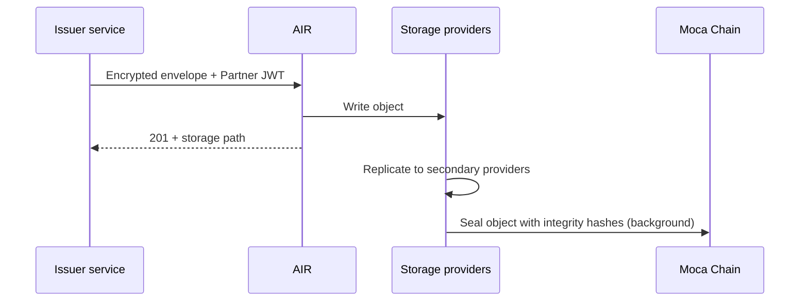
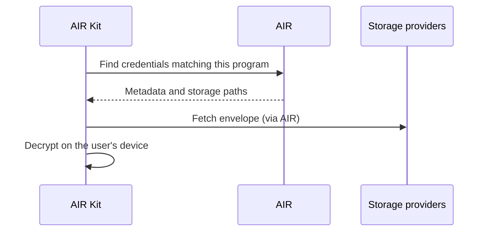

A credential is stored as an **encrypted envelope** in DStorage, Moca Chain's decentralized storage network. Storage providers hold the ciphertext, Moca Chain records metadata about it, and AIR keeps an index so the user's credentials can be found. Only the user can decrypt it.

## The storage layers

| Layer | What it holds | Who runs it | Readable by |
| --- | --- | --- | --- |
| **Issuer systems** | Source records. With a database: an issuance record (holder, revocation number, revoked flag). | Issuer | Issuer |
| **AIR** | An index: holder DID, credential format, schema, expiry, storage path | AIR | AIR |
| **Storage providers** (DStorage) | The encrypted envelope | Independent Moca Chain Storage Providers | Ciphertext only. The holder can decrypt. |
| **Moca Chain** | Object metadata, integrity hashes, and status records. Iden3 on-chain verification results. | Validators | Public |
| **Issuer domain** | Public keys, DID document, optional revocation list | Issuer | Public |

The credential itself is never written to the chain in readable form.

## The envelope

The issuer encrypts the complete signed credential to the user's encryption key before it leaves the issuer's service:

1. It creates a one-time X25519 key pair for this credential.
2. It combines the one-time private key with the user's public X25519 key (key agreement) to get a shared secret, then derives a 256-bit key from it with HKDF-SHA256.
3. It encrypts the credential with AES-256-GCM, which also produces a tag that detects any tampering.

The envelope sent for storage has two kinds of fields:

| Encrypted | Cleartext, for indexing |
| --- | --- |
| `data`: the encrypted credential | `holderDid`: whose credential it is |
| `iv`: the encryption's random starting value | `proofType`: `SD_JWT_VC` or `BJJ_SIG_2021` |
| `authTag`: the tamper-detection tag | `schemaId`: the credential type |
| `encryptedKey`: the one-time public key the user needs to decrypt | `expiresAt`: the expiry |
| | `externalId`: the issuer's unique ID, so retries cannot create duplicates |

The user decrypts by combining their X25519 private key with `encryptedKey`, deriving the same AES key, and checking the tag. SD-JWT and Iden3 credentials use the same envelope.

## From issuer to storage

1. **The issuer calls AIR's DStorage API** with the envelope, authenticated by a Partner JWT with the `issue` scope. The issuer never talks to storage providers directly.
2. **AIR writes the envelope as a storage object** on Moca Chain Storage Providers, which offer an S3-style object API.
3. **AIR returns a storage path right away** (`201`), such as `dstorage://vc/…`, and adds the credential to its index. The bytes can be read immediately.
4. **The primary provider stores the payload**, and secondary providers in its virtual group receive replicas. Each one computes an integrity hash and signs it.
5. **The object is sealed on Moca Chain in the background.** The primary provider submits the signed integrity hashes, and validators record the object's metadata by consensus. Poll `GET /dstorage/vcs/status?path=<storagePath>` until `status` is `STORED` if you need to confirm it.

## How availability is enforced

Validators and challenger nodes regularly challenge storage providers to prove they still hold the data they sealed. A provider that cannot answer, or that leaves the network without handing over its data, loses part of its stake. Storage providers join through a governance vote and must stake to operate.

## How a credential is retrieved

AIR answers discovery from its index, using only the cleartext metadata. The envelope travels to the user's device still encrypted, and is decrypted there.

{/* TODO: Confirm whether AIR Kit fetches envelopes from storage providers directly or through an AIR endpoint. */}

## Retention and deletion

- Revoking a credential does not delete it from storage. It marks it invalid.
- On-chain metadata is permanent and may remain linkable to a user even after an account is deleted.
- Copies of claims already disclosed to verifiers are outside AIR's control.

See [Data privacy](/technicals/architecture/data-privacy) for how deletion requests are handled.

## Related

- [Moca Chain storage providers](/technicals/mocachain/decentralized-storage) for provider internals
- [Keys & cryptography](/technicals/architecture/keys-and-cryptography) for exact algorithms and parameters
- [Issuance API reference](/api-reference/issuance-api) for the DStorage API fields
