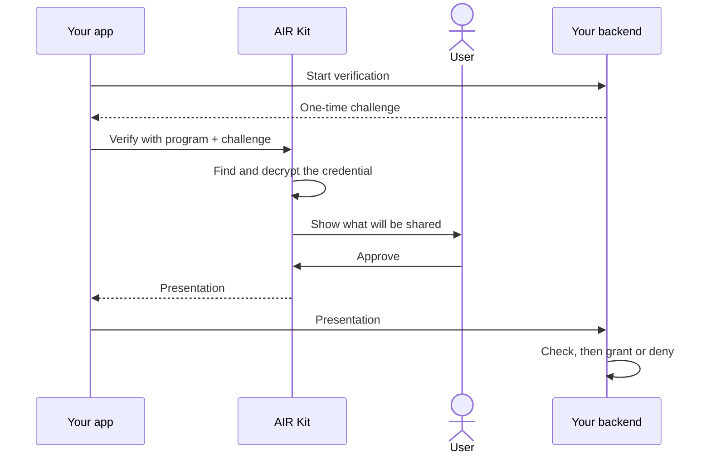

Verification lets an app check a fact about a user, such as "holds a Gold membership", without seeing anything else. The user's device finds the matching credential, the user approves what is shared, and the app receives a **presentation**: the approved claims, still carrying the issuer's signature. The app's backend checks that signature before acting on it.

## The verification program decides what to check

Apps do not describe the check in code. They pass a **program ID**, and the verification program configured in the Developer Dashboard defines:

| Setting | Example |
| --- | --- |
| Credential type and format | Membership credentials in the default SD-JWT format |
| Conditions | Tier must be Gold |
| Claims to share | Only the tier, not name or points |
| Trusted issuers (optional) | Only credentials from a specific issuer DID |
| Revocation check | Ask the issuer whether the credential was revoked |

Changing what you require is a Dashboard change, not a code deploy.

## The flow

1. **Challenge.** Your backend creates a one-time random challenge (a nonce) for this attempt.
2. **Find and decrypt.** AIR Kit finds the user's matching credential in encrypted storage and decrypts it on the user's device. AIR only handles ciphertext.
3. **Consent.** The user sees exactly which claims will be shared. If they decline, nothing is shared.
4. **Present.** AIR Kit builds the presentation: the issuer-signed credential with only the approved claims, plus the user's signature over your challenge.
5. **Check.** AIR Kit checks the presentation in the browser for a quick answer. Your backend then checks it properly before granting anything.

<Warning>
  The browser's `Compliant` result is not proof to your backend; it is not signed. Only the presentation is. See [Checking a presentation](/technicals/architecture/how-credential-verification-works/backend-checks).
</Warning>

## Ways to verify

| Where verification runs | Use it when | Read more |
| --- | --- | --- |
| **In your app, with AIR Kit** | The user is present in your web or mobile app | This section |
| **On a server, by an agent** | An AI agent acts for the user, with the user's prior approval | [How agentic commerce works](/technicals/architecture/how-agentic-commerce-works) |
| **With a zero-knowledge proof** | You need to prove a condition without revealing the value, or verify on-chain | [Zero-knowledge verification](/technicals/architecture/how-credential-verification-works/zero-knowledge) |

## In this section

<CardGroup cols={2}>
  <Card title="What the verifier receives" icon="envelope-open" href="/technicals/architecture/how-credential-verification-works/presentation">
    The parts of a presentation and what each one proves.
  </Card>
  <Card title="Checking a presentation" icon="list-check" href="/technicals/architecture/how-credential-verification-works/backend-checks">
    What your backend checks, and why.
  </Card>
  <Card title="Results and errors" icon="circle-info" href="/technicals/architecture/how-credential-verification-works/results">
    Every outcome and how to handle it.
  </Card>
  <Card title="Zero-knowledge verification" icon="eye-slash" href="/technicals/architecture/how-credential-verification-works/zero-knowledge">
    Proving conditions with Iden3 credentials.
  </Card>
</CardGroup>

To build a verifier, follow the developer guide: [Verifying credentials](/products/identity/verify).
