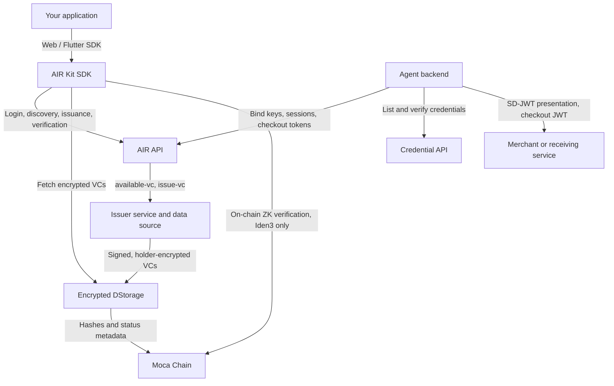

AIR Kit connects your application to AIR services and Moca Chain. It exposes **Account Services** for authentication and wallet operations and **Credential Services** for orchestrating issuance and verification. Your issuer backend owns credential authorization, source data, signing, encryption, and storage.

## System overview

| Component | Responsibility | Sees plaintext claims? |
| --- | --- | --- |
| **AIR Kit SDK** | Login, issuance confirmation, decryption on the holder's device, consent, presentation building | Yes, on the holder's device only |
| **AIR API** | Partner authentication, holder key resolution, routing to issuers, DStorage writes, agent keys and sessions | No |
| **Credential API** | Server-side credential listing and verification for agents | Only claims disclosed by the program |
| **Issuer service** | Authorization, claim loading, SD-JWT signing, envelope encryption, revocation | Yes: it is the source of truth |
| **DStorage** | Stores encrypted credential envelopes | No |
| **Moca Chain** | Storage metadata, hashes, status records, and Iden3 issuer state and on-chain verification | No |

The SDK manages user interaction and calls AIR APIs. AIR routes issuance requests to the registered issuer service. The issuer service owns authorization, source data, credential creation and signing, encryption, and storage. Credential storage and on-chain proof verification are separate operations. See [Account Services](/get-started/authentication/login) for login and wallet details, and [Keys & cryptography](/technicals/architecture/keys-and-cryptography) for every key and token involved.

## How each flow works

<CardGroup cols={2}>
  <Card title="Credential issuance" icon="badge-check" href="/technicals/architecture/how-credential-issuance-works">
    Trust setup, SD-JWT construction, holder binding, X25519 + AES-256-GCM envelope encryption, DStorage, and revocation.
  </Card>
  <Card title="Credential verification" icon="magnifying-glass" href="/technicals/architecture/how-credential-verification-works">
    Programs, holder-side decryption, selective disclosure, key-binding JWTs, backend checks, and ZK proofs.
  </Card>
</CardGroup>

## Issuance modes

| Mode | User presence | How it works |
| --- | --- | --- |
| **On-demand issuance** | User present | The user reviews encrypted previews and confirms issuance through the SDK. AIR then calls the issuer's `issue-vc`. |
| **Direct issuance** | Can run without the user present | The issuer resolves the holder's keys with `initialize-user`, then creates and stores the credential. The user finds it when they log in to AIR. |

In every mode the issuer builds the SD-JWT, binds it to the holder's P-256 key (`cnf.jwk`), signs it with its `did:web` key, encrypts it to the holder's X25519 key, and stores the envelope in DStorage. AIR never sees the plaintext. See [How credential issuance works](/technicals/architecture/how-credential-issuance-works).

## Verification at a glance

<Steps>
  <Step title="Start verification">
    The partner app calls `verifyCredential()` with a verification program and a backend-generated nonce. The SDK loads the program and ensures the holder is logged in to AIR.
  </Step>
  <Step title="Find a matching credential">
    The SDK requests matching credential metadata and DStorage paths. If none exists, verification cannot succeed: pass `redirectUrl` to send the user to an accepted issuer, and handle the `credential/not-eligible` rejection.
  </Step>
  <Step title="Decrypt and review">
    The SDK fetches the encrypted credential, decrypts it on the holder's device, and shows the requested claims.
  </Step>
  <Step title="Consent and present">
    After consent, the SDK attaches only the requested disclosures and signs a key-binding JWT over your nonce and `programId`.
  </Step>
  <Step title="Verify on your backend">
    The SDK returns the result and Verifiable Presentation. Your backend verifies the SD-JWT and KB-JWT before acting on it.
  </Step>
</Steps>

### Off-chain and on-chain verification

The verification program selects the mode. Both paths use the credential discovery, decryption, and consent steps above.

| Mode | Where verification runs | What the app receives |
| --- | --- | --- |
| **Off-chain** | The proof or presentation is checked outside a blockchain transaction against the program's requirements. | Verification status and the presentation/proof material applicable to the program. |
| **On-chain** | The proof is submitted for verification on-chain. This mode is available only for [Iden3](/products/identity/iden3-credentials) `BJJ_SIG_2021` credentials. | The verification outcome and applicable on-chain transaction information. |

Using DStorage or anchoring issuer state does not, by itself, mean that verification runs on-chain. The verification mode describes where the proof is checked. See [How credential verification works](/technicals/architecture/how-credential-verification-works).

## Agents at a glance

An agent backend binds a key to the user's AIR Account with the user's consent and a fixed set of scopes. It then mints a 15-minute agent JWT per operation, runs verification programs server-side through the Credential API, and, with `commerce.checkout`, mints a checkout token whose audience is a single merchant. Identity binding never grants wallet or payment authority. See [How agentic commerce works](/technicals/architecture/how-agentic-commerce-works).

## Integrating with existing systems

Your issuer backend can connect to loyalty platforms, KYC providers, ticketing systems, and payment processors. Those systems can trigger Direct Issuance, while the SDK supports user-present issuance, later claims, and verification. See the [vertical integration guides](/airkit/guides/air-for-loyalty) for examples.

## Service independence and login requirements

Choose the service capabilities your app needs. An AIR login is required for the user-present credential flows below; it does not imply that your app must also integrate wallet operations, gas sponsorship, or other Account Services features.

| Credential flow | Service | AIR login requirement |
| --- | --- | --- |
| On-demand issuance | Credential Services | User logs in before reviewing and confirming issuance. |
| Direct issuance | Credential Services | No active user session required to issue; user logs in to claim later. |
| SDK verification | Credential Services | User logs in before reviewing the requested data and consenting. |

## Next steps

<Columns cols={2}>
  <Card title="Quick Setup" icon="bolt" href="/get-started/dashboard/account-setup">
    Install and initialize the SDK in minutes.
  </Card>
  <Card title="Solutions by vertical" icon="puzzle-piece" href="/solutions">
    Business overview and developer guide for Loyalty, Identity, Fintech, Gaming, Ticketing, Telco, and Advertising.
  </Card>
  <Card title="Quickstart: Issue Credentials" icon="badge-check" href="/get-started/quickstarts/issue-credentials">
    Step-by-step credential issuance walkthrough.
  </Card>
  <Card title="Direct Issuance" icon="server" href="/airkit/guides/overview#direct-issuance-flow">
    Issue without an active user session; users claim credentials when they log in.
  </Card>
</Columns>
